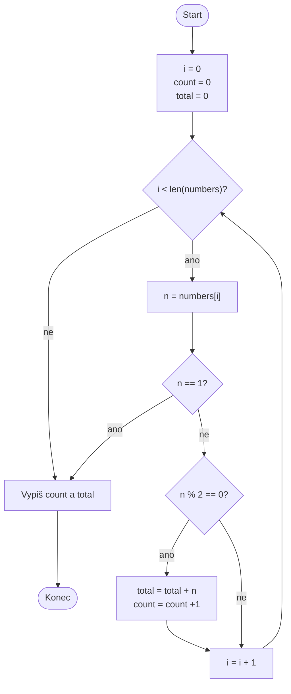

0
```mermaid

%%(["это либо старт либо конец"])
%%["прямоугольник, для действий, присваиваний или вычислений"]
%%%{"ромб, для вопросов или условий"}
%%[/"паралелограм, для ввода или вывода"/]

```



```mermaid
    flowchart TD
    start([Start])-->prirovnavani1["N = 5
    total = 0"]-->dej1["Zadej N čísel"]-->porovnavani1{"1<=i<=N"}
    porovnavani1 -- ano -->dej2["Načti x"]-->prirovnavani2["total += x"]-->kn([Konec])
    porovnavani1 -- ne -->


```